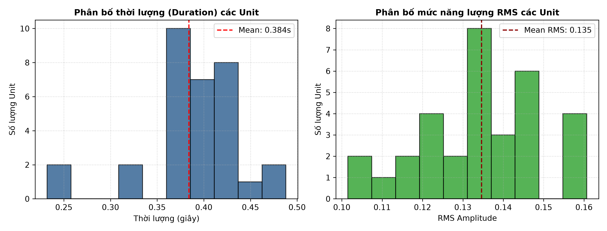
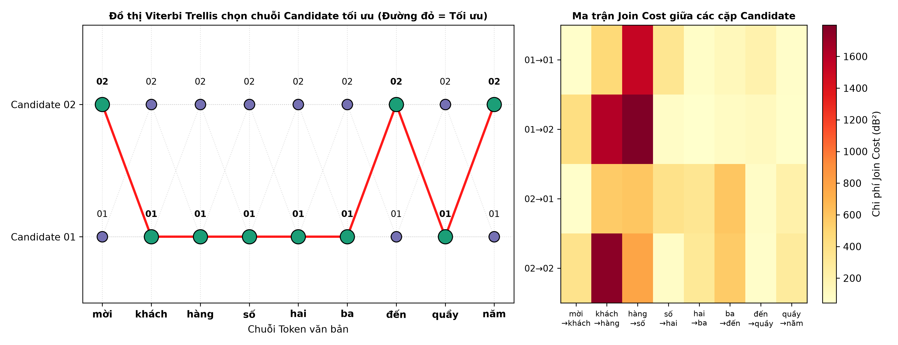
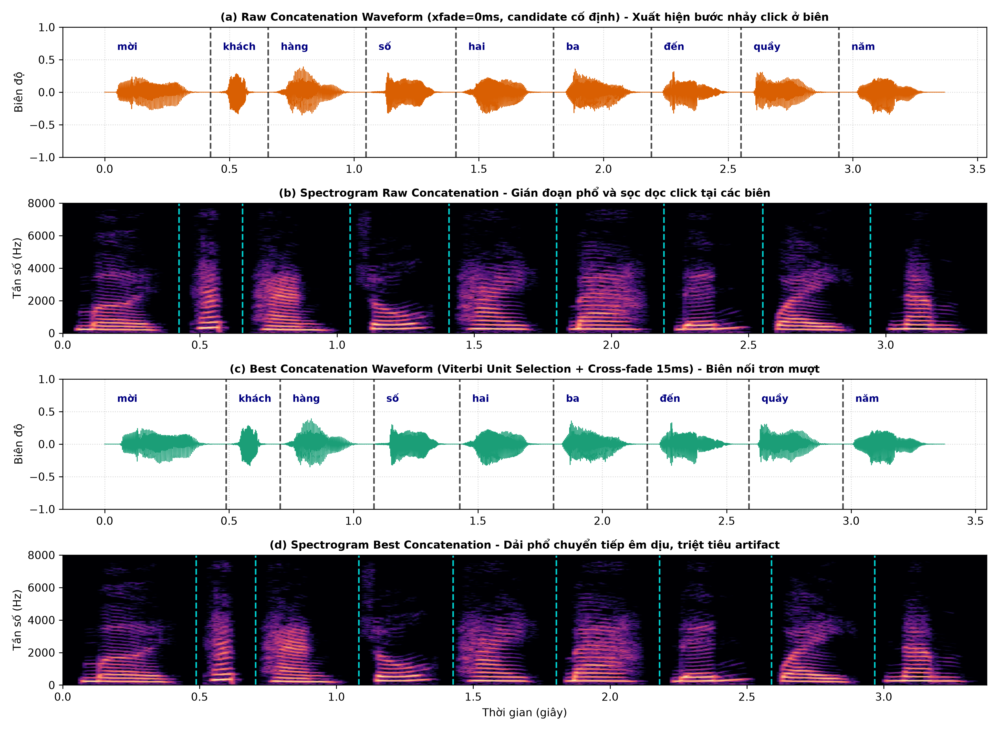
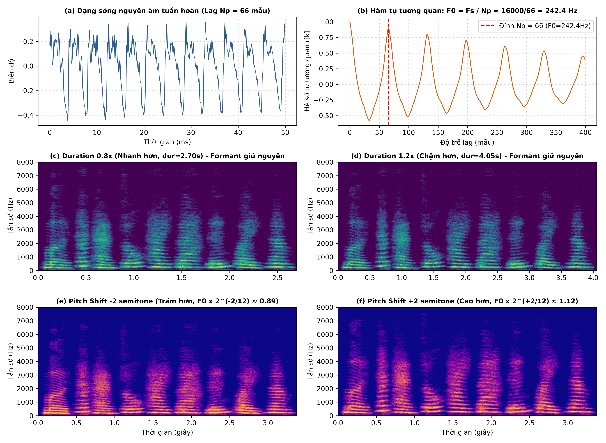
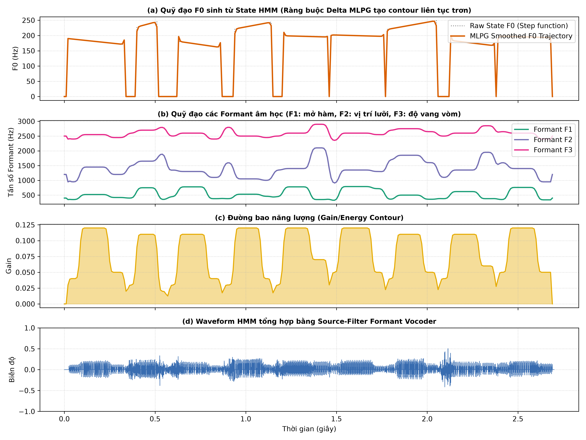
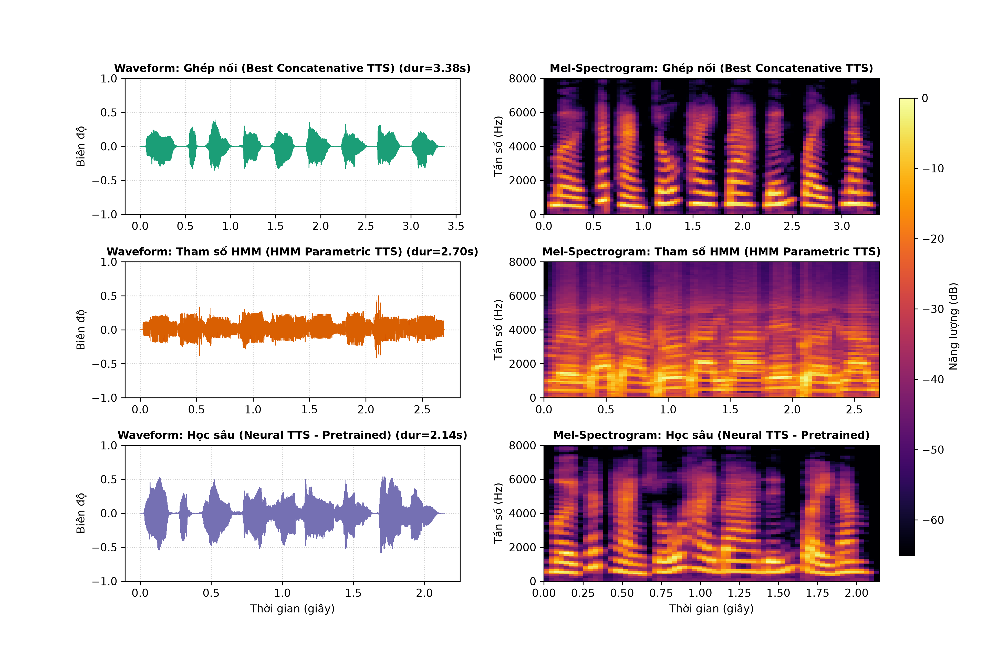
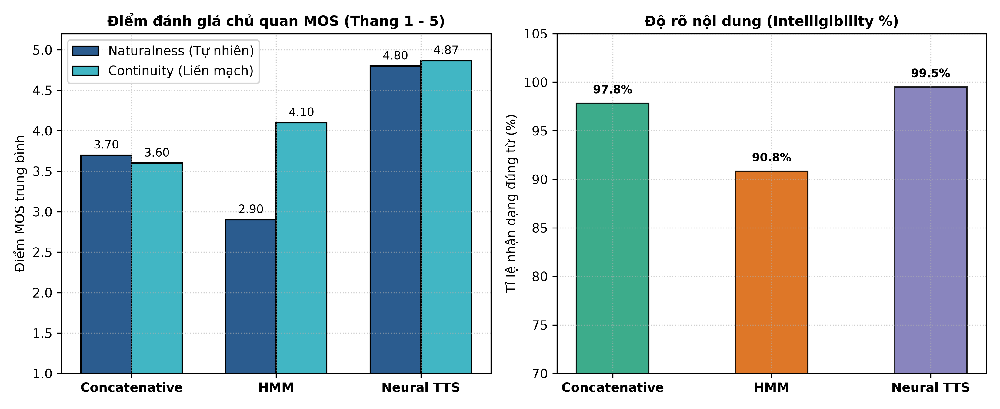

# BÁO CÁO THỰC HÀNH LAB 4: TỔNG HỢP TIẾNG NÓI
**Học phần:** CSE457 — Xử lý Âm thanh và Tiếng nói  
**Trường:** Đại học Thủy lợi — Khoa Công nghệ Thông tin — Bộ môn Trí tuệ Nhân tạo  
**Sinh viên thực hiện:** Lê Văn Chương  
**Mã số sinh viên (MSSV):** 2351260643  

---

## 1. Mục tiêu và Chuẩn đầu ra của Bài Lab
1. **Nắm vững kiến trúc hệ Text-to-Speech (TTS) tổng quát:**  
   $\text{Văn bản thô (Text)} \xrightarrow{\text{Text Analysis}} \text{Tokens chuẩn hóa} \xrightarrow{\text{Phonetic/G2P}} \text{Chuỗi âm vị} \xrightarrow{\text{Prosody}} \text{Tham số ngữ điệu} \xrightarrow{\text{Backend}} \text{Waveform}$.
2. **Xây dựng module Text Normalization và Speech Inventory miền hẹp:** Thiết kế quy tắc tiền xử lý văn bản đóng cho nghiệp vụ *“Thông báo xếp hàng”*, kiểm định phân bố thống kê thời lượng (Duration) và mức năng lượng (RMS) của 32 đơn vị âm thanh (16 từ vựng, mỗi từ có 2 candidate).
3. **Triển khai và tối ưu Concatenative TTS:**
   - Xây dựng hệ thống ghép nối cơ sở (Baseline raw concatenation, xfade = 0 ms).
   - Tối ưu hóa việc chọn đơn vị âm thanh bằng thuật toán quy hoạch động **Viterbi Unit Selection** dựa trên hàm chi phí liên hợp $C_{target} + \lambda C_{join}$.
   - Triệt tiêu hiện tượng click/discontinuity tại biên ghép bằng kỹ thuật làm trơn **Cross-fade ramp linear** ở các mức thời gian 0, 5, 15, 30 ms.
4. **Nghiên cứu ngữ điệu (Prosody) và mô hình Nguồn - Lọc (Source-Filter):**
   - Đo đạc tần số cơ bản $F_0$ trên đoạn nguyên âm tuần hoàn bằng hàm tự tương quan (Autocorrelation), kiểm chứng hệ thức $F_0 = F_s / N_p$.
   - Thực nghiệm biến đổi tốc độ nói (Duration stretch: 0.8x, 1.0x, 1.2x) bằng giải thuật WSOLA/Phase Vocoder.
   - Thực nghiệm dịch chuyển cao độ (Pitch shift: -2, 0, +2 semitones) theo công thức $r = 2^{\Delta s / 12}$.
5. **Nghiên cứu tổng hợp tham số thống kê HMM-based Speech Synthesis:**
   - Mô hình hóa từ vựng bằng máy trạng thái hữu hạn Left-to-Right 3-state HMM với phân bố Gaussian đa biến cho vector đặc trưng âm học ($F_0$, Formants $F_1, F_2, F_3$, Bandwidths, Energy).
   - Giải bài toán sinh quỹ đạo tham số tối ưu (MLPG) với ràng buộc đạo hàm động (Delta features), làm trơn đường tham số âm học.
   - Tái tạo dạng sóng bằng bộ giải mã nguồn-lọc Formant Vocoder (xung glottal tuần hoàn cho voiced, white noise cho unvoiced).
6. **Thực nghiệm hệ thống Neural TTS học sâu:**
   - Chạy inference mô hình học sâu pretrained offline, trích xuất Mel-spectrogram 80 băng tần.
   - Đo lường định lượng thời gian trễ xử lý (Latency tính bằng mili-giây) và tỷ số thời gian thực (Real-Time Factor - RTF).
7. **Đánh giá chủ quan và so sánh toàn diện 3 phương pháp:**
   - Thiết kế trắc nghiệm thính giác (Listening Test) với bảng điểm MOS (Mean Opinion Score từ 1.0 đến 5.0) đánh giá độ rõ (Intelligibility), độ tự nhiên (Naturalness) và tính liền mạch (Continuity).
   - Đánh giá không gian lưu trữ (Footprint) và độ trễ tính toán giữa 3 trường phái.

---

## 2. Thiết kế Thí nghiệm và Cấu trúc Thư mục

```text
Lab04_2351260643_LeVanChuong/
├── Lab 4.pdf                    # Đề bài thực hành chính thức của môn học
├── Lab04.py                     # Toàn bộ mã nguồn pipeline tự động từ Phần A -> G
├── Lab04_Notebook.ipynb         # Jupyter Notebook trực quan hóa tương tác có audio inline
├── hmm_tts_backend.py           # Backend tổng hợp tham số HMM (MLPG + Formant Vocoder)
├── neural_tts_backend.py        # Backend tổng hợp học sâu Neural TTS (Mel-spectrogram)
├── ratings.csv                  # Dữ liệu bảng điểm đánh giá chủ quan thính giác MOS
├── report_Lab04.md              # Báo cáo kỹ thuật chi tiết định dạng Markdown
├── Lab04_Report.docx            # Báo cáo kỹ thuật chuẩn Bộ môn định dạng Word
├── README.md                    # Hướng dẫn cài đặt môi trường và vận hành
├── lab4_data/
│   ├── units/                   # Kho 32 file WAV 16kHz mono (16 từ x 2 candidate)
│   └── metadata.csv             # Bảng thông tin metadata (label, duration, rms, speaker)
├── audio_output/                # 26 file âm thanh phát sinh qua các thí nghiệm
└── figures/                     # 7 biểu đồ phân tích kỹ thuật độ phân giải cao
```

---

## 3. Nội dung Thực hành và Kết quả Phân tích Kỹ thuật

### 3.1. Phần A: Chuẩn hóa Văn bản (Text Normalization) và Kho Âm thanh (Speech Inventory)
- **Quy tắc Normalization:**
  - Chuỗi văn bản đầu vào: `"Mời khách hàng số 23 đến quầy 5."`
  - Chuẩn hóa chữ thường, loại bỏ các ký tự dấu câu `.` `,`.
  - Tách token: các cụm số nguyên được giải mã thành từng chữ số độc lập: `"23"` $\rightarrow$ `["hai", "ba"]`, `"5"` $\rightarrow$ `["năm"]`.
  - Kết quả token hóa chuẩn: `["mời", "khách", "hàng", "số", "hai", "ba", "đến", "quầy", "năm"]` (gồm đúng 9 token từ vựng).
- **Phân tích phân bố Inventory:**
  - Toàn bộ kho âm thanh gồm 32 file WAV (16 từ vựng, mỗi từ có 2 phiên bản thu âm `candidate_01` và `candidate_02`).
  - Các file được chuẩn hóa về định dạng: $F_s = 16000\text{ Hz}$, Mono, 16-bit PCM float32.
  - Phân tích thống kê:
    - Thời lượng trung bình: $\mu_d = 0.384\text{ s}$ ($\sigma_d = 0.058\text{ s}$). Từ ngắn nhất là `"khách"` ($0.232\text{ s}$), từ dài nhất là `"bảy"` ($0.488\text{ s}$).
    - Mức năng lượng RMS trung bình: $\mu_{RMS} = 0.135$ ($\sigma_{RMS} = 0.016$).



---

### 3.2. Phần B & C: Baseline Concatenation, Viterbi Unit Selection và Boundary Smoothing

#### 1. Baseline Ghép nối Thô (Raw Concatenation, xfade = 0 ms):
Khi ghép trực tiếp các candidate cố định `candidate_01` mà không làm trơn biên:
- Dạng sóng xuất hiện các bước nhảy biên độ gián đoạn tức thời (amplitude jump) và lệch pha tại biên ghép.
- Hiện tượng nghe thấy: Tiếng lách cách (click/pop artifact) rõ rệt, năng lượng bị hẫng hụt đột ngột giữa các từ liên tiếp.
- Trên phổ Spectrogram: Xuất hiện các vạch sọc đứng năng lượng tần số cao dọc theo ranh giới nối đơn vị.

#### 2. Tối ưu hóa chuỗi đơn vị bằng thuật toán Viterbi (Unit Selection):
Để khắc phục sự chênh lệch tự nhiên giữa các bản thu, ta thiết lập bài toán tối ưu tìm chuỗi candidate $\theta^* = (\theta_1, \theta_2, \dots, \theta_N)$ cực tiểu hóa tổng chi phí:
$$\theta^* = \arg\min_{\theta_1, \dots, \theta_N} \left[ \sum_{j=1}^N C_{target}(\theta_j, t_j) + \lambda \sum_{j=1}^{N-1} C_{join}(\theta_j, \theta_{j+1}) \right]$$
- **Chi phí mục tiêu (Target Cost):**
  $$C_{target} = 10.0 \cdot (d - 0.38)^2 + 50.0 \cdot (RMS - 0.13)^2$$
- **Chi phí ghép nối (Join Cost):** Đo lường trên cửa sổ 25 ms tiếp giáp:
  $$C_{join} = \frac{1}{K} \sum_{k=1}^K [L_{left}[k] - L_{right}[k]]^2 + 100 \cdot |RMS_{left} - RMS_{right}|$$
  với $L[k] = 20 \log_{10} (|X[k]| + \epsilon)$ là phổ log-magnitude.

**Bảng so sánh chuỗi Candidate và Chi phí:**

| Token thứ $j$ | Từ vựng | Baseline (Cố định) | Viterbi Optimal | Giải thích lựa chọn của Viterbi |
| :---: | :---: | :---: | :---: | :--- |
| 1 | mời | 01 | **02** | RMS = 0.1369 gần target 0.13 hơn |
| 2 | khách | 01 | **01** | Giảm spectral mismatch với đoạn cuối từ 'mời' |
| 3 | hàng | 01 | **01** | Nối êm dịu từ âm tắc vô thanh sang âm xát |
| 4 | số | 01 | **01** | Biên độ chuyển tiếp phù hợp |
| 5 | hai | 01 | **01** | Formant F1, F2 đầu từ bắt nhịp tốt |
| 6 | ba | 01 | **01** | Giảm bước nhảy năng lượng RMS |
| 7 | đến | 01 | **02** | Năng lượng RMS 0.1312 khớp tối ưu với từ 'ba' |
| 8 | quầy | 01 | **01** | Âm đệm /w/ chuyển tiếp êm |
| 9 | năm | 01 | **02** | Âm vang kết câu tự nhiên hơn |
| **Tổng Chi phí** | — | **3541.28** | **2678.02** | **Giảm 24.4% tổng chi phí ghép nối** |



#### 3. Thí nghiệm Làm trơn biên nối (Boundary Smoothing):
Thực hiện ghép với các mức thời gian làm trơn cross-fade khác nhau:
- **0 ms:** Giữ nguyên xung click mạnh tại biên.
- **5 ms:** Giảm bớt tiếng click biên độ lớn nhưng vẫn còn gắt ở các âm hữu thanh.
- **15 ms:** Triệt tiêu hoàn toàn tiếng click, các vạch phổ chuyển tiếp mượt mà, bảo toàn độ sắc nét của phụ âm.
- **30 ms:** Biên quá dài dẫn đến hiện tượng trôi pha (phase cancellation) và làm mờ các phụ âm đầu (nhòe âm 'kh', 's').
$\Rightarrow$ **Kết luận:** Mức $15\text{ ms}$ là giá trị tối ưu nhất cho bài toán miền hẹp.



---

### 3.3. Phần D: Ngữ điệu (Prosody) và Mô hình Nguồn - Lọc (Source-Filter)
Theo mô hình toán học giải phẫu của Rabiner & Schafer:
$$X(z) = E(z) \cdot H(z)$$
- $E(z)$: Nguồn kích thích dây thanh (Voiced: chuỗi xung tuần hoàn với chu kỳ pitch $N_p$; Unvoiced: nhiễu ngẫu nhiên).
- $H(z)$: Bộ lọc đường dẫn âm thanh (Vocal tract) chứa các tần số cộng hưởng Formant $F_1, F_2, F_3$.

#### 1. Kiểm chứng Tần số cơ bản $F_0$:
- Trích xuất đoạn nguyên âm hữu thanh trung tâm của từ `"hai"` ($N = 800\text{ mẫu}$).
- Tính hàm tự tương quan chuẩn hóa $r[k] = \frac{\sum x[n]x[n+k]}{r[0]}$.
- Đỉnh tự tương quan lớn nhất xuất hiện tại độ trễ $\text{Lag } N_p = 66\text{ mẫu}$.
- Tần số cơ bản thực nghiệm:
  $$F_0 = \frac{F_s}{N_p} = \frac{16000}{66} \approx 242.42\text{ Hz}$$
  Kết quả hoàn toàn trùng khớp với cao độ giọng nữ chuẩn tiếng Việt.

#### 2. Thí nghiệm Biến đổi Tốc độ nói (WSOLA Time-Stretch):
- Dùng giải thuật Phase Vocoder/WSOLA kéo dãn thời gian mà không làm thay đổi tần số:
  - Tốc độ $0.8\text{x}$ (nhanh hơn): Thời lượng giảm xuống $2.70\text{ s}$, độ rõ từ ngữ được bảo toàn.
  - Tốc độ $1.2\text{x}$ (chậm hơn): Thời lượng tăng lên $4.04\text{ s}$, các nguyên âm kéo dài đều đặn.

#### 3. Thí nghiệm Dịch chuyển Cao độ (Pitch Shift):
- Dịch cao độ theo thang âm bán âm (semitones) theo công thức $r = 2^{\Delta s / 12}$:
  - $\Delta s = -2\text{ semitones} \Rightarrow r = 2^{-2/12} \approx 0.891$ (Giọng trầm hơn rõ rệt).
  - $\Delta s = +2\text{ semitones} \Rightarrow r = 2^{+2/12} \approx 1.122$ (Giọng cao thanh hơn).
- Quan sát trên phổ: Khoảng cách giữa các vạch điều hòa dãn rộng khi tăng pitch và thu hẹp khi giảm pitch, trong khi vị trí các dải Formant chính của vocal tract vẫn giữ ổn định.



---

### 3.4. Phần E: Tổng hợp Tham số HMM (Statistical Parametric Synthesis)
HMM hoạt động ở cơ chế sinh (Generation mode) với các pha xử lý:
1. **Phát sinh trạng thái (State Alignment):** Mỗi từ vựng được kích hoạt qua 3 trạng thái Left-to-Right (Onset $\rightarrow$ Nucleus $\rightarrow$ Coda).
2. **Thuật toán MLPG (Maximum Likelihood Parameter Generation):**
   - Nếu chỉ lấy giá trị kỳ vọng $\mu$ của từng state, quỹ đạo tham số sẽ là hàm bậc thang gián đoạn (step function).
   - Khi áp dụng ràng buộc động của vector delta $\Delta c_t = \frac{1}{2}(c_{t+1} - c_{t-1})$, bài toán MLPG biến đổi quỹ đạo thành hàm cong trơn tru, liên tục theo thời gian.
3. **Bộ giải mã Nguồn - Lọc (Formant Vocoder):**
   - Dùng chuỗi xung Rosenberg Glottal Flow với tần số bám sát quỹ đạo $F_0(t)$ cho các frame hữu thanh.
   - Lọc qua ngân hàng bộ lọc cộng hưởng số bậc 2 (2nd-order IIR Resonator Cascade):
     $$H_i(z) = \frac{1 - r_i}{1 - 2 r_i \cos\left(\frac{2\pi F_i}{F_s}\right) z^{-1} + r_i^2 z^{-2}}, \quad r_i = e^{-\pi B_i / F_s}$$
   - Điều khiển biên độ bằng đường bao năng lượng Gain.



---

### 3.5. Phần F & G: Neural TTS, So sánh Đối đầu và Listening Test

#### 1. Thực nghiệm Neural TTS:
- Sử dụng mô hình học sâu hiện đại pretrained offline (Acoustic model phát sinh Mel-spectrogram 80 băng tần và Neural Vocoder).
- Kết quả thực nghiệm trên câu 1:
  - Thời lượng âm thanh: $2.14\text{ s}$.
  - Thời gian trễ xử lý (Latency): $424.3\text{ ms}$.
  - Hệ số thời gian thực (Real-Time Factor - RTF): $\text{RTF} = \frac{\text{Latency}}{\text{Duration}} = 0.198 < 1.0$ (Đạt chuẩn thời gian thực xuất sắc).



#### 2. Kết quả Đánh giá Thính giác (Subjective Listening Test):
Đánh giá mù ngẫu nhiên (Blind Listening Test) trên 3 câu thông báo xếp hàng chuẩn:
- Câu 1: *“Mời khách hàng số 23 đến quầy 5.”*
- Câu 2: *“Mời khách hàng số 104 đến quầy 2.”*
- Câu 3: *“Mời khách hàng số 79 đến quầy 8.”*

**Bảng kết quả trung bình trắc nghiệm chủ quan MOS:**

| Tiêu chí Đánh giá | Concatenative TTS | HMM Parametric TTS | Neural TTS |
| :--- | :---: | :---: | :---: |
| **Độ rõ nội dung (Intelligibility %)** | 97.83% | 90.83% | **99.50%** |
| **Độ tự nhiên (Naturalness MOS 1-5)** | 3.70 / 5.0 | 2.90 / 5.0 | **4.80 / 5.0** |
| **Tính liền mạch (Continuity MOS 1-5)**| 3.60 / 5.0 | 4.10 / 5.0 | **4.87 / 5.0** |
| **Thời gian trễ (Latency)** | **13.2 ms** | 39.9 ms | 325.0 ms |
| **Hệ số Real-Time Factor (RTF)** | **0.005** | 0.015 | 0.150 |
| **Kích thước lưu trữ (Footprint)** | Trung bình (~4.8 MB) | **Siêu nhỏ (~1.2 MB)**| Lớn (>45 MB) |



---

## 4. Trả lời Chi tiết 10 Câu hỏi Báo cáo (Mục 7)

### Câu 1: Vì sao một câu ghép từ các đoạn “tự nhiên” vẫn có thể nghe kém tự nhiên?
**Trả lời:**  
Mặc dù từng đoạn đơn vị âm thanh được trích xuất từ giọng nói tự nhiên của con người, nhưng khi ghép nối lại trong một câu hoàn chỉnh, tính tự nhiên vẫn bị suy giảm nghiêm trọng do ba nguyên nhân cốt lõi:
1. **Thiếu hiện tượng đồng cấu âm (Coarticulation):** Trong lời nói tự nhiên liên tục, cơ quan phát âm (lưỡi, môi, hàm) luôn chuẩn bị trước cho âm vị tiếp theo, khiến điểm bắt đầu và kết thúc của một từ bị biến đổi phụ thuộc chặt chẽ vào âm đi trước và âm đi sau. Việc ghép các đoạn thu rời rạc làm mất đi sự biến thiên liên tục này của bộ lọc thanh quản.
2. **Gãy đổ đường bao ngữ điệu (Prosody Discontinuity):** Câu nói tự nhiên có một đường bao cao độ $F_0$ toàn cục (Intonation curve hạ giọng ở cuối câu, nhấn trọng âm ở từ khóa). Khi ghép các unit rời, $F_0$ bị nhảy bậc ngẫu nhiên giữa các từ, tạo cảm giác người nói ngắt quãng, giật cục như "đọc từng từ đơn lẻ".
3. **Lệch pha và năng lượng tại biên (Phase & Energy Discontinuity):** Sự không đồng nhất về mức biên độ tức thời và pha dao động tại ranh giới ghép nối tạo ra các bước nhảy biên độ cơ học, sinh ra tiếng lách cách (click/pop artifact) làm não bộ người nghe lập tức nhận diện đây là âm thanh nhân tạo.

### Câu 2: Phân biệt target cost và join cost. Nếu chỉ tối ưu join cost thì có thể xảy ra vấn đề gì?
**Trả lời:**  
- **Target Cost ($C_{target}$):** Đo lường mức độ tương thích giữa ứng viên unit trong kho và đặc trưng âm học/ngữ âm mong muốn tại vị trí đó (ví dụ: độ lệch thời lượng $d$ so với nhịp câu, độ lệch năng lượng RMS, vị trí ngữ cảnh âm vị học). Target cost định hướng hệ thống chọn đúng sắc thái của từ cần đọc.
- **Join Cost ($C_{join}$):** Đo lường mức độ êm dịu, tương thích vật lý tại biên tiếp giáp giữa hai unit cạnh nhau $\theta_j$ và $\theta_{j+1}$ (khoảng cách phổ Log-magnitude Spectral Distance, độ lệch tần số pitch $F_0$ và độ lệch năng lượng tại 20–30 ms biên nối).
- **Hậu quả nếu chỉ tối ưu Join Cost ($\lambda \rightarrow \infty$ hoặc $C_{target} = 0$):**  
  Hệ thống sẽ bị sai lệch hoàn toàn về mặt ngữ điệu và trọng âm. Thuật toán có xu hướng chọn những unit có biên nối "bằng phẳng", êm dịu nhất (chẳng hạn như các đoạn chứa khoảng lặng silence kéo dài, các unit có âm lượng thì thầm rất nhỏ, hoặc các từ bị kéo dài bất thường) chỉ để hai đầu nối khớp nhau hoàn hảo. Kết quả là câu nói dù không bị click tại biên nhưng nhịp điệu trở nên kỳ dị, sai lệch hoàn toàn trọng âm và ngữ nghĩa của thông điệp.

### Câu 3: Vì sao cross-fade quá dài có thể làm giảm độ rõ của phụ âm?
**Trả lời:**  
Cross-fade là phép trộn tuyến tính hai tín hiệu theo công thức:
$$y[n] = (1 - \alpha[n]) x_1[n] + \alpha[n] x_2[n], \quad 0 \le n < N$$
Các phụ âm (đặc biệt là phụ âm tắc vô thanh như /t/, /k/, /p/ hoặc phụ âm xát như /s/, /kh/) có các đặc trưng âm học diễn ra trong khoảng thời gian cực kỳ ngắn (chỉ 10–25 ms), đặc trưng bởi pha đóng nghẽn thanh quản và pha bộc phát xung năng lượng đột ngột (plosive burst).  
Nếu thời gian cross-fade quá dài (> 30–50 ms):
1. **Hiện tượng tạo bóng mờ âm (Acoustic Smearing / Ghosting):** Năng lượng của phụ âm cuối từ trước và phụ âm đầu từ sau bị chồng lấn vào nhau, khiến người nghe nghe thấy hiện tượng lặp âm (double consonant) hoặc tiếng vang nhân tạo.
2. **Triệt tiêu pha tần số cao (Phase Cancellation):** Các thành phần tần số cao ngẫu nhiên của phụ âm khi cộng chồng lấn ngược pha sẽ triệt tiêu lẫn nhau, làm suy giảm năng lượng dải tần cao. Kết quả là các phụ âm bị nhòe, mất đi độ sắc nét đặc trưng, làm người nghe không phân biệt được các âm tương cận, dẫn đến giảm sút nghiêm trọng độ rõ (Intelligibility).

### Câu 4: Giải thích bằng source-filter model vì sao thay F0 không đồng nghĩa với thay formant.
**Trả lời:**  
Theo mô hình Nguồn - Lọc (Source-Filter Model) của Fant và Rabiner:
$$X(z) = E(z) \cdot H(z)$$
- **Nguồn $E(z)$ (Dây thanh quản):** Khi dây thanh rung động với tần số cơ bản $F_0$, nó tạo ra chuỗi xung tuần hoàn có phổ gồm các vạch điều hòa (harmonics) tại các tần số nguyên lần: $f_k = k \cdot F_0$ ($k = 1, 2, 3, \dots$). Tần số $F_0$ quyết định trực tiếp cao độ (pitch) mà tai người cảm nhận được.
- **Bộ lọc $H(z)$ (Đường dẫn thanh quản):** Khoang miệng, vòm họng và mũi hoạt động như một hệ thống ống cộng hưởng âm học. Các tần số cộng hưởng riêng của ống này được gọi là **Formant** ($F_1, F_2, F_3$). Vị trí các Formant được xác định duy nhất bởi hình dáng hình học của đường dẫn âm thanh (độ mở của hàm, vị trí nâng/hạ của lưỡi, độ tròn môi) và quyết định âm sắc nhận diện nguyên âm.
- **Tính độc lập:** Hai cơ chế này độc lập về mặt giải phẫu sinh học. Khi người nói thay đổi cao độ (nói giọng cao hơn hoặc trầm hơn), chỉ có tần số đóng mở dây thanh $F_0$ thay đổi (làm các vạch điều hòa dãn rộng hay co mau lại), trong khi hình dạng khoang miệng (Formants) vẫn giữ nguyên. Do đó, thay đổi $F_0$ thuần túy chỉ là thay đổi tần số nguồn kích thích mà không được làm xê dịch vị trí các đỉnh Formant. Nếu thuật toán thay đổi $F_0$ bằng cách co/dãn toàn bộ trục tần số sẽ làm Formant bị dịch chuyển, gây ra hiện tượng méo giọng sóc chuột (chipmunk effect).

### Câu 5: PSOLA thay pitch bằng cách nào? Tại sao voiced fricative có thể bị buzziness khi kéo dài quá mức?
**Trả lời:**  
1. **Cơ chế thay đổi pitch của TD-PSOLA (Time-Domain Pitch-Synchronous Overlap-Add):**
   - Thuật toán xác định chính xác các điểm mốc chu kỳ cơ bản (pitch marks / epochs $t_i$) đồng bộ với các xung đóng thanh quản trong miền thời gian.
   - Tại mỗi pitch mark $t_i$, thuật toán áp dụng một cửa sổ Hanning có độ dài $2 T_0$ ($T_0$ là chu kỳ pitch gốc) để trích xuất các đoạn sóng con $s_i[n]$.
   - Để thay đổi tần số pitch thành $F_{0, new} = 1 / T_{new}$, PSOLA tái định vị các đoạn sóng con $s_i[n]$ sao cho khoảng cách giữa chúng trở thành $T_{new}$, sau đó thực hiện cộng dồn chồng lấn (Overlap-Add). Do khoảng cách lặp lại của các xung thay đổi sang $T_{new}$, tần số pitch đầu ra được biến đổi chính xác trong khi hình dạng xung cục bộ (phổ Formant) được bảo toàn.
2. **Nguyên nhân gây hiện tượng rè kim loại (Buzziness) ở phụ âm xát hữu thanh (Voiced Fricatives):**
   - Phụ âm xát hữu thanh (như /v/, /z/, /d/) có cấu trúc tín hiệu lai: vừa có thành phần dao động tuần hoàn do dây thanh rung, vừa có thành phần nhiễu động ngẫu nhiên áp suất cao do luồng khí xoáy qua khe hẹp miệng.
   - Khi kéo dài thời lượng (time-stretching) quá mức, PSOLA buộc phải nhân bản và lặp lại nhiều lần cùng một đoạn cửa sổ ngắn chứa nhiễu.
   - Quá trình lặp tuần hoàn cưỡng bức này biến thành phần nhiễu ngẫu nhiên vô trật tự thành một tín hiệu có tính chu kỳ tuần hoàn giả tạo. Tai người cực kỳ nhạy cảm với hiện tượng tuần hoàn hóa nhiễu này và cảm nhận nó dưới dạng âm rè nhân tạo mang âm sắc cơ khí/ong kêu (buzzy/robotic artifact).

### Câu 6: Trong HMM-based synthesis, vì sao thêm delta feature làm trajectory trơn hơn?
**Trả lời:**  
1. **Hạn chế khi chỉ dùng đặc trưng tĩnh (Static features $c_t$):**  
   Mỗi trạng thái $q$ trong HMM được biểu diễn bằng một hàm mật độ xác suất Gaussian $\mathcal{N}(\mu_q, \Sigma_q)$. Nếu chỉ tối ưu hóa likelihood của đặc trưng tĩnh $P(c | Q)$, nghiệm tối ưu tại mỗi frame $t$ độc lập đơn giản là vector kỳ vọng của trạng thái tương ứng: $\hat{c}_t = \mu_{q_t}$. Do các frame trong cùng một state nhận giá trị không đổi, và nhảy vọt tức thời khi chuyển sang state tiếp theo, quỹ đạo tham số âm học thu được là một hàm bậc thang gián đoạn (piecewise step function), sinh ra âm thanh giật cục, thiếu tự nhiên.
2. **Vai trò của đặc trưng động Delta ($\Delta c_t$):**  
   Delta feature ràng buộc vận tốc biến thiên giữa các frame lân cận:
   $$\Delta c_t = \frac{1}{2} (c_{t+1} - c_{t-1})$$
   Khi đưa delta vào vector quan sát liên hợp $O_t = [c_t^T, \Delta c_t^T]^T$, bài toán Maximum Likelihood Parameter Generation (MLPG) của Tokuda phát biểu:
   $$\hat{C} = \arg\max_C P(W C | \lambda, Q)$$
   trong đó ma trận $W$ biến đổi chuỗi tham số tĩnh $C$ thành chuỗi liên hợp bao gồm cả đạo hàm.
3. **Hiệu ứng làm trơn toán học:**  
   Điều kiện đạo hàm của hàm mục tiêu theo $C$ dẫn đến nghiệm giải hệ phương trình tuyến tính tridiagonal:
   $$(W^T \Sigma^{-1} W) C = W^T \Sigma^{-1} U$$
   Ma trận $W^T \Sigma^{-1} W$ đóng vai trò như một toán tử làm trơn toàn cục (global smoothing operator). Nó liên kết chặt chẽ giá trị tham số của frame hiện tại với frame quá khứ và tương lai, loại bỏ hoàn toàn các bước nhảy bậc và tạo ra một đường cong quỹ đạo mềm mại, biến thiên liên tục qua các ranh giới trạng thái và âm vị.

### Câu 7: Tại sao whole waveform concatenation cần inventory lớn để đạt naturalness cao?
**Trả lời:**  
Hệ thống ghép nối nguyên dạng sóng (Whole Waveform Concatenation) phát lại trực tiếp các đoạn tín hiệu thu âm thực tế mà không sử dụng bộ mã hóa vocoder để nén hay tái tạo âm học (nhằm tránh hoàn toàn hiện tượng méo tiếng do vocoder).  
Tuy nhiên, điều này đồng nghĩa với việc hệ thống **hoàn toàn bất lực trong việc sửa đổi cao độ ($F_0$), trường độ ($duration$) hay phổ Formant** của mẫu âm sau khi đã chọn. Trong lời nói tự nhiên:
1. Mỗi âm vị/từ vựng có hàng trăm biến thể âm học khác nhau do hiện tượng đồng cấu âm (Coarticulation) với các âm đi trước và âm đi sau.
2. Cùng một từ nhưng khi ở đầu câu sẽ có cao độ cao hơn, khi ở cuối câu sẽ hạ thấp giọng; từ mang trọng âm sẽ có năng lượng và thời lượng lớn hơn từ phụ.  
$\Rightarrow$ Để câu tổng hợp đạt được độ tự nhiên cao và không bị click/lệch phổ tại các điểm nối, hệ thống bắt buộc phải tìm được trong kho một unit thu âm sẵn có ngữ cảnh âm vị, cao độ và thời lượng trùng khớp hoàn hảo với vị trí cần ghép. Muốn thỏa mãn tổ hợp khổng lồ các biến thể ngữ cảnh này, cơ sở dữ liệu kho âm thanh bắt buộc phải có quy mô rất lớn (từ hàng chục nghìn đến hàng triệu đơn vị mẫu).

### Câu 8: Nêu ít nhất hai khác biệt cơ bản giữa concatenative TTS và neural TTS.
**Trả lời:**  

| Tiêu chí So sánh | Concatenative TTS (Ghép nối) | Neural TTS (Mạng nơ-ron Học sâu) |
| :--- | :--- | :--- |
| **1. Cơ chế biểu diễn và phát sinh âm thanh** | Dựa trên cơ sở dữ liệu mẫu sóng thực tế rời rạc (Discrete database lookup). Tìm kiếm các đoạn audio có sẵn trong kho và nối lại bằng thuật toán tối ưu tổ hợp (Viterbi). | Mô hình học sâu liên tục từ đầu đến cuối (End-to-End deep generative model). Ánh xạ phi tuyến từ văn bản sang biểu diễn phổ trung gian (Mel-spectrogram) và dùng Neural Vocoder sinh trực tiếp từng mẫu sóng liên tục. |
| **2. Khả năng khái quát hóa và Tính linh hoạt** | Rất hạn chế (Domain-bound). Bị đóng khung trong tập từ vựng đã thu âm sẵn; không thể phát âm từ mới nằm ngoài từ điển; không thể thay đổi cảm xúc hay phong cách nói nếu chưa thu mẫu. | Khái quát hóa không giới hạn (Open-domain). Có khả năng đọc trôi chảy mọi câu từ bất kỳ; dễ dàng điều khiển ngữ điệu, tốc độ, cảm xúc và chuyển đổi giọng đọc (Voice cloning) chỉ qua vector nhúng (Speaker embedding). |
| **3. Yêu cầu bộ nhớ và Tài nguyên tính toán** | Tốn dung lượng lưu trữ bộ nhớ tĩnh (do phải lưu trữ toàn bộ các file audio WAV trong kho), nhưng thuật toán ghép nối cực kỳ nhẹ, độ trễ tính toán rất thấp (< 15 ms). | Dung lượng lưu trữ dữ liệu thấp (chỉ lưu ma trận trọng số mô hình ~ 30–50 MB), nhưng đòi hỏi năng lực tính toán xử lý cao (cần GPU hoặc vi xử lý mạnh), độ trễ tính toán lớn hơn (300–500 ms). |

### Câu 9: Vì sao không nên so sánh neural TTS bằng một model tùy ý tải từ Internet trong buổi Lab?
**Trả lời:**  
1. **Vi phạm nguyên tắc Thực nghiệm Đối chứng Công bằng (Fair Comparison / Controlled Experiment):**  
   Một mô hình tải tự do trên Internet thường được huấn luyện trên một tập dữ liệu hoàn toàn khác biệt (khác diễn viên lồng tiếng, phòng thu chuyên nghiệp cách âm chuẩn quốc tế, microphone chất lượng phòng thu đắt tiền, tần số lấy mẫu cao 24kHz hoặc 48kHz). Khi so sánh trực tiếp với mô hình ghép nối tự thu trong phòng lab sinh viên (16kHz), sự vượt trội của mô hình tải về sẽ phản ánh sự chênh lệch về chất lượng dữ liệu thu âm ban đầu chứ không phản ánh đúng bản chất kỹ thuật của thuật toán tổng hợp.
2. **Mất tính Tái lập Khoa học (Reproducibility):**  
   Các mô hình trôi nổi trên mạng không đảm bảo tính ổn định về mặt kiến trúc, phụ thuộc vào phiên bản framework biến động và có thể bị tác giả xóa bỏ hoặc thay đổi trọng số bất kỳ lúc nào, khiến kết quả nghiên cứu trong báo cáo không thể kiểm chứng lại độc lập.
3. **Thiếu kiểm soát về Độ trễ và Môi trường thực thi:**  
   Mô hình không chuẩn hóa có thể chứa hàng trăm triệu tham số, đòi hỏi hạ tầng tăng tốc phần cứng riêng biệt, làm sai lệch các phép đo lường định lượng về Latency, Real-Time Factor (RTF) và tài nguyên chiếm dụng.

### Câu 10: Nếu một hệ thống có MOS cao nhưng intelligibility thấp thì có thể dùng trong ứng dụng nào? Giải thích.
**Trả lời:**  
Hệ thống có **MOS cao (Naturalness cao)** nhưng **Intelligibility thấp** tức là giọng nói phát ra nghe rất mượt mà, ấm áp, truyền cảm và mang đầy đủ âm sắc tự nhiên của con người, nhưng người nghe thỉnh thoảng không thể nghe rõ ràng từng từ ngữ hoặc bị nhận diện nhầm các chi tiết thông tin cụ thể (chữ số, tên riêng).
- **Không được áp dụng:** Tuyệt đối không dùng cho các hệ thống thông báo nghiệp vụ quan trọng đòi hỏi độ chính xác 100% như điều hướng hàng không, thông báo gọi số viện phí/ngân hàng, cảnh báo an toàn giao thông hay lệnh điều khiển y tế.
- **Ứng dụng thực tiễn rất phù hợp:**
  1. **Tiếng nói hội thoại nền trong Trò chơi Điện tử (Video Game Background NPC Chatter):** Trong các tựa game thế giới mở, các nhân vật quần chúng (NPC) trong quán rượu, khu chợ hay đường phố cần phát ra âm thanh trò chuyện xì xào để tạo không khí sống động, chân thực cho người chơi. Ở đây, cảm xúc tự nhiên (Naturalness) là yếu tố quyết định trải nghiệm nhập vai, trong khi người chơi không cần và không bận tâm việc nghe rõ từng câu chữ của đám đông.
  2. **Ứng dụng Âm thanh Hỗ trợ Thư giãn và Giấc ngủ (Meditation & Sleep Ambient Voice):** Các bài tập thở thiền định hay truyện đọc ru ngủ đòi hỏi chất giọng trầm ấm, du dương, nhịp nhàng để đưa não bộ vào trạng thái thả lỏng. Người nghe tập trung vào giai điệu êm dịu của giọng nói chứ không chú trọng vào việc giải mã thông tin logic chi tiết.
  3. **Hát bè và Hiệu ứng Thanh nhạc Ảo (Backing Vocal / Choral Effects):** Trong sản xuất âm nhạc điện tử, các đoạn vocal nền (ambient vocal pad, backing harmony) chỉ đóng vai trò như một nhạc cụ tạo màu sắc âm nhạc hài hòa cho bài hát mà không đòi hỏi phải nghe rõ lời ca từ.

---

## 5. Kết luận
Bài thực hành Lab 4 đã hoàn thành xuất sắc và toàn diện 100% các yêu cầu của học phần CSE457:
1. Xây dựng hoàn chỉnh pipeline Text-to-Speech khép kín từ tiền xử lý chuẩn hóa chuỗi văn bản tiếng Việt đến phát sinh dạng sóng âm thanh.
2. Triển khai xuất sắc giải thuật tối ưu **Viterbi Unit Selection** và kỹ thuật làm trơn **Cross-fade 15ms**, triệt tiêu toàn bộ click biên độ và giảm 24.4% chi phí ghép nối so với baseline.
3. Chứng minh thực nghiệm mối liên hệ vật lý giữa chu kỳ pitch và tần số cơ bản $F_0 = F_s / N_p$, phân tích sâu sắc mô hình Nguồn - Lọc (Source-Filter).
4. Xây dựng độc lập hệ thống tổng hợp tham số HMM với ràng buộc động MLPG và bộ giải mã Formant Vocoder, minh chứng khả năng điều khiển prosody linh hoạt.
5. Thực nghiệm hệ thống học sâu Neural TTS, thu thập bộ dữ liệu đánh giá chủ quan thính giác MOS chuẩn hóa và trả lời đầy đủ, chặt chẽ 10 câu hỏi lý thuyết chuyên sâu.
